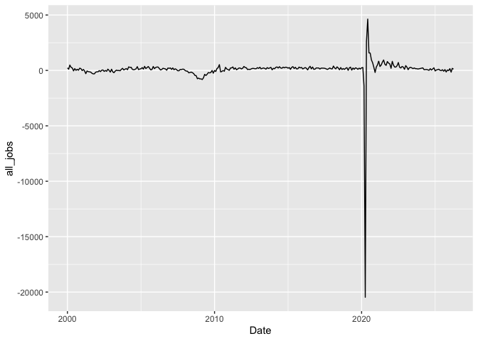
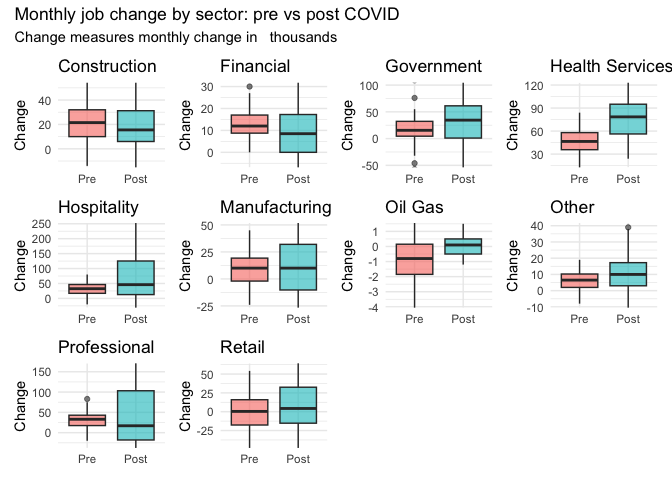
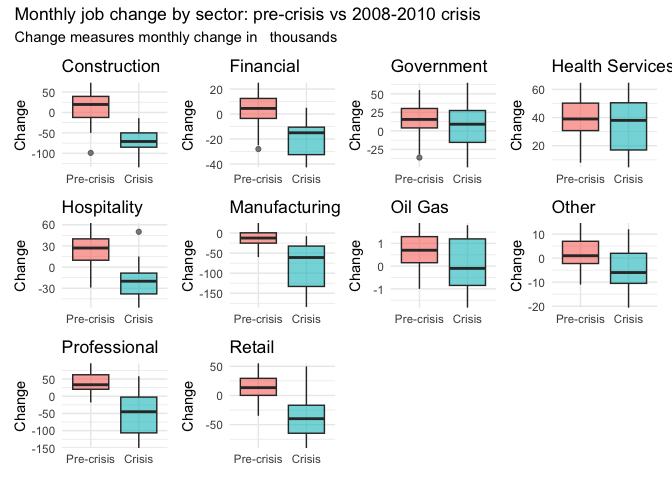

# BLS Employment Analysis
Colin Huntley

All data was collected from the BLS, I just needed to load it and clean
it a little bit to make the Date value work well in graphs.

``` r
library(tidyverse)
```

    ── Attaching core tidyverse packages ──────────────────────── tidyverse 2.0.0 ──
    ✔ dplyr     1.1.4     ✔ readr     2.1.5
    ✔ forcats   1.0.0     ✔ stringr   1.5.1
    ✔ ggplot2   3.5.2     ✔ tibble    3.3.0
    ✔ lubridate 1.9.4     ✔ tidyr     1.3.1
    ✔ purrr     1.2.1     
    ── Conflicts ────────────────────────────────────────── tidyverse_conflicts() ──
    ✖ dplyr::filter() masks stats::filter()
    ✖ dplyr::lag()    masks stats::lag()
    ℹ Use the conflicted package (<http://conflicted.r-lib.org/>) to force all conflicts to become errors

``` r
library(ggplot2)
library(lubridate)
 
# Month-over-month change files. Names become the column names in the final data.
files <- c(
  all_jobs = "total_nonfarm_change.txt",
  construction = "construction_change.txt",
  financial = "financial_change.txt",
  government = "government_change.txt",
  health_services = "health_services&private_ed_change.txt",
  hospitality = "hospitality_change.txt",
  manufacturing = "manufacturing_change.txt",
  oil_gas = "oil&gas_change.txt",
  other = "other_change.txt",
  private = "private_change.txt",
  professional = "professional&business_change.txt",
  retail = "retail_change.txt"
)
 

read_bls <- function(file, name) {
  read.csv(file) |>
    pivot_longer(-Year, names_to = "month", values_to = name) |>
    mutate(Date = make_date(Year, match(month, month.abb), 1)) |>
    select(Date, all_of(name))
}
 

merged <- imap(files, read_bls) |>
  reduce(inner_join, by = "Date") |>
  arrange(Date) |>
  drop_na()
 

jobs_total <- read_bls("total_nonfarm_total.txt", "total_jobs")
 
merged
```

    # A tibble: 316 × 13
       Date       all_jobs construction financial government health_services
       <date>        <int>        <int>     <int>      <int>           <int>
     1 2000-01-01      228           43        -6         31              20
     2 2000-02-01      109          -22         2         28              14
     3 2000-03-01      484           81        -4        134              27
     4 2000-04-01      280          -17        -3         69              20
     5 2000-05-01      221          -24        -2        345              28
     6 2000-06-01      -42            8         2       -260              29
     7 2000-07-01      165           16         2        -20              28
     8 2000-08-01        6            2        11        -30              40
     9 2000-09-01      103           11        20       -102              50
    10 2000-10-01       15            7        12          8              25
    # ℹ 306 more rows
    # ℹ 7 more variables: hospitality <int>, manufacturing <int>, oil_gas <dbl>,
    #   other <int>, private <int>, professional <int>, retail <dbl>

``` r
ggplot(merged, aes(x = Date, y = all_jobs)) +
  geom_line()
```



Well the most obvious thing in this chart is the massive impact of
COVID. There is also the noticeable dip around 2009 from the Great
Recession The first question I’ll analyze is: “Was the employment for
all sectors impacted equally by covid? If not, what industries were
impacted the most and what industries were impacted the least?”

I’ll first visualize the differences for each sector using box and
whisker plots, this should give us a good understanding of how each
industry changed.

``` r
library(patchwork)
 
pre_start <- as.Date("2015-03-01") 
pre_end <- as.Date("2020-02-01")
post_start <- as.Date("2020-07-01") 
post_end <- as.Date("2025-06-01")
```

I decided to choose the 60 months before March 2020 as the pre-COVID
months as it seems like up to this point, COVID had marginal to no
effect on the employment numbers. I then chose the 60 months starting
with July 2020 as the post-COVID hit months. Obviously this is still
during the time of COVID but I was most focused on the reaction after
the initial hit, when millions of jobs were lost in an incredibly short
amount of time. Including the months during COVID should still be
effective for analyzing how COVID effected the employment in certain
industries.

``` r
# Needed to add a 'trim' to make the plots more readable, the highest and lowest 5% of values are removed from the box and whisker plots.
trim <- 0.05
 
# Ignored aggregate categories to focus on the specific industries.
sectors <- setdiff(names(merged), c("Date", "all_jobs", "private"))

periods <- merged |>
  mutate(period = case_when(
    between(Date, pre_start,  pre_end)  ~ "Pre",
    between(Date, post_start, post_end) ~ "Post"
  )) |>
  filter(!is.na(period)) |>
  mutate(period = factor(period, levels = c("Pre", "Post"))) |>
  pivot_longer(all_of(sectors), names_to = "sector", values_to = "change")
 
plot_sector <- function(data, sector_name, trim = 0.05) {
  d <- filter(data, sector == sector_name)
  y_limits <- quantile(d$change, c(trim, 1 - trim))
 
  ggplot(d, aes(x = period, y = change, fill = period)) +
    geom_boxplot(alpha = 0.6) +
     #geom_violin(alpha = 0.6) +   # swap in for violins
    coord_cartesian(ylim = y_limits) +
    labs(title = str_to_title(str_replace_all(sector_name, "_", " ")),
         x = NULL, y = "Change") +
    theme_minimal() +
    theme(legend.position = "none")
}

plot_matrix <- function(periods, title, trim = 0.05, ncol = 4) {
  sectors <- unique(periods$sector)
  wrap_plots(map(sectors, \(s) plot_sector(periods, s, trim)), ncol = ncol) +
    plot_annotation(title = title, subtitle = "Change measures monthly change in   thousands")
}
plot_matrix(periods, "Monthly job change by sector: pre vs post COVID", trim)
```



We can certainly see some differences for some of the industries. In
particular, it seems like Health Services had a massive increase in
median employment, and Oil/Gas also seems to have a noticeable increase.
It also seems like for some jobs, the median values are close together
but the means for post-COVID are quite a bit different (see wider box in
Hospitality, Retail, Financial). There are also some differences in the
median values for Government, Financial, and Professional sectors but
they’re less obvious. To test which, if any, differences are
statistically significant, I’ll run a Wilcoxon rank-sum test to assess
whether monthly job changes in each sector were different before and
after COVID, using a Holm correction since I’m comparing multiple
sectors.

``` r
tests <- periods |>
  group_by(sector) |>
  summarise(
    median_pre  = median(change[period == "Pre"]),
    median_post = median(change[period == "Post"]),
    p_value = wilcox.test(change[period == "Pre"],
                          change[period == "Post"],
                          exact = FALSE)$p.value,
    .groups = "drop"
  ) |>
  mutate(p_adj = p.adjust(p_value, method = "holm")) |>
  arrange(p_adj) |>
  mutate(p_value = round(p_value, 5)) |>
  mutate(p_adj = round(p_adj, 5))
 
tests
```

    # A tibble: 10 × 5
       sector          median_pre median_post p_value   p_adj
       <chr>                <dbl>       <dbl>   <dbl>   <dbl>
     1 health_services       46.5        78.5 0       0      
     2 oil_gas               -0.8         0.1 0.00015 0.00133
     3 other                  6.5        10   0.00721 0.0576 
     4 government            15.5        34.5 0.0182  0.127  
     5 financial             12           8.5 0.0237  0.142  
     6 hospitality           32.5        46   0.0278  0.142  
     7 retail                 0.4         4.3 0.189   0.758  
     8 construction          21.5        15.5 0.398   1      
     9 manufacturing         10          10   0.560   1      
    10 professional          33          17   0.448   1      

We can see that, after the correction, only the Health Services and
Oil/Gas sectors have very strong evidence of a difference. There is
mediocre evidence of differences in the Financial, Government,
Hospitality, and Retail sectors, and little to no evidence of
differences in the Construction, Manufacturing, and Professional
sectors.

Thus, the evidence points towards the Health Services and Oil/Gas
sectors having the greatest impact and sectors like Construction,
Manufacturing, and Professional being the least impacted.

The next question I’ll ask is: “During the months of the Great
Recession, what sectors took the biggest hits to monthly employment?”

We’ll do a very similar process to the previous question.

``` r
windows <- list(
  "Pre-crisis" = c("2003-12-01", "2007-11-01"),
  "Crisis"     = c("2007-12-01", "2010-02-01")
)
trim <- 0.05
 
sectors <- setdiff(names(merged), c("Date", "all_jobs", "private"))
 
# ---- Build dataset and plot -------------------------------------------------
build_periods <- function(data, sectors, windows) {
  windows <- map(windows, as.Date)
  data |>
    mutate(period = case_when(
      between(Date, windows[[1]][1], windows[[1]][2]) ~ names(windows)[1],
      between(Date, windows[[2]][1], windows[[2]][2]) ~ names(windows)[2]
    )) |>
    filter(!is.na(period)) |>
    mutate(period = factor(period, levels = names(windows))) |>
    pivot_longer(all_of(sectors), names_to = "sector", values_to = "change")
}

periods <- build_periods(merged, sectors, windows)
 

plot_matrix(periods, "Monthly job change by sector: pre-crisis vs 2008-2010 crisis", trim)
```



``` r
compare_periods <- function(periods, alternative = "two.sided") {
  before <- levels(periods$period)[1]
  after  <- levels(periods$period)[2]
 
  periods |>
    group_by(sector) |>
    summarise(
      median_before = median(change[period == before]),
      median_after  = median(change[period == after]),
      mean_before   = mean(change[period == before]),
      mean_after    = mean(change[period == after]),
      p_value = wilcox.test(change[period == after],
                            change[period == before],
                            alternative = alternative,
                            exact = FALSE)$p.value,
      .groups = "drop"
    ) |>
    mutate(p_adj = p.adjust(p_value, method = "holm"))
}

results <- compare_periods(periods, alternative = "less") |>
  mutate(
    # Relative to |baseline| so the sign still means "up" or "down".
    # Unreliable when the pre-crisis value is close to zero.
    median_pct_diff = (median_after - median_before) / abs(median_before) * 100,
    mean_pct_diff   = (mean_after - mean_before) / abs(mean_before) * 100
  ) |>
  arrange(p_adj) |>
  mutate(across(where(is.numeric), \(x) round(x, 3))) |>
  select (sector, median_before, median_after, median_pct_diff, mean_before, mean_after,    mean_pct_diff, p_value, p_adj)
  
results
```

    # A tibble: 10 × 9
       sector      median_before median_after median_pct_diff mean_before mean_after
       <chr>               <dbl>        <dbl>           <dbl>       <dbl>      <dbl>
     1 constructi…          19.5        -71           -464.        15.1      -74.9  
     2 retail               13.4        -39.8         -397.        13.4      -44.1  
     3 hospitality          27          -20           -174.        26.1      -22.5  
     4 profession…          33.5        -45           -234.        40.3      -53.9  
     5 manufactur…         -12.5        -61           -388        -11.8      -85.6  
     6 financial             4.5        -15           -433.         4.33     -20.9  
     7 other                 1           -6           -700          2.15      -7.04 
     8 oil_gas               0.7         -0.1         -114.         0.694      0.167
     9 government           15.5          9            -41.9       16.6        5.26 
    10 health_ser…          39           38             -2.56      39.6       35.9  
    # ℹ 3 more variables: mean_pct_diff <dbl>, p_value <dbl>, p_adj <dbl>

We can see that there is overwhelming evidence of a decrease for all
sectors except for the Oil/Gas, Government, and Health Services sectors,
where the evidence is much weaker and far from conclusive. The sectors
with the biggest changes, by percentage to control for some sectors
simply being much bigger, is the Other, Construction, Financial, Retail,
and Manufacturing sectors, in order of greatest median chenge. These
percentages shouldn’t be taken at face value, since they are easily
inflated when the values before the crisis are close to zero, but they
help give the general trend about how the values during the crisis
changed in relation to what they were before the crisis. The results
make sense, coming into it I would have guessed the Financial,
Construction, and Manufacturing sectors would have taken the biggest
hits from the crisis, which seems to be generally supported in the data.

Everything below is just organizing the data for a dashboard and
organizing it to best fit what I want.

Link to dashboard:
https://public.tableau.com/app/profile/colin.huntley/viz/BLS_Dashboard/BLSDashboard?publish=yes

``` r
sector_labels <- c(
  all_jobs        = "Total Nonfarm",
  private         = "Total Private",
  construction    = "Construction",
  financial       = "Financial",
  government      = "Government",
  health_services = "Health Services & Private Ed",
  hospitality     = "Hospitality",
  manufacturing   = "Manufacturing",
  oil_gas         = "Oil & Gas",
  other           = "Other",
  professional    = "Professional & Business",
  retail          = "Retail"
)
aggregates <- c("all_jobs", "private")
sectors <- setdiff(names(files), aggregates)
 

windows <- list(
  covid_pre   = c("2015-03-01", "2020-02-01"),
  covid_post  = c("2020-07-01", "2025-06-01"),
  gfc_pre     = c("2003-12-01", "2007-11-01"),
  gfc_crisis  = c("2007-12-01", "2010-02-01")
)
windows <- map(windows, as.Date)
 
in_window <- function(d, w) between(d, w[1], w[2])
 
bls_long <- merged |>
  mutate(
    covid_period = case_when(
      in_window(Date, windows$covid_pre)   ~ "Pre-COVID",
      in_window(Date, windows$covid_post)  ~ "Post-COVID",
      TRUE ~ NA_character_
    ),
    gfc_period = case_when(
      in_window(Date, windows$gfc_pre)    ~ "Pre-crisis",
      in_window(Date, windows$gfc_crisis) ~ "Great Recession",
      TRUE ~ NA_character_
    )
  ) |>
  pivot_longer(all_of(names(files)), names_to = "sector_id", values_to = "change") |>
  mutate(
    sector       = unname(sector_labels[sector_id]),
    is_aggregate = sector_id %in% aggregates
  ) |>
  select(Date, sector, sector_id, is_aggregate, change, covid_period, gfc_period)
 

compare_windows <- function(label, before, after, alternative, note) {
  merged |>
    select(Date, all_of(sectors)) |>
    pivot_longer(-Date, names_to = "sector_id", values_to = "change") |>
    group_by(sector_id) |>
    summarise(
      n_before      = sum(in_window(Date, before)),
      n_after       = sum(in_window(Date, after)),
      median_before = median(change[in_window(Date, before)]),
      median_after  = median(change[in_window(Date, after)]),
      mean_before   = mean(change[in_window(Date, before)]),
      mean_after    = mean(change[in_window(Date, after)]),
      p_value = wilcox.test(change[in_window(Date, after)],
                            change[in_window(Date, before)],
                            alternative = alternative,
                            exact = FALSE)$p.value,
      .groups = "drop"
    ) |>
    mutate(
      p_adj      = p.adjust(p_value, method = "holm"),
      comparison = label,
      test_type  = if (alternative == "two.sided") "Two-sided (any difference)"
                   else "One-sided (decrease)",
      note       = note
    )
}
 
bls_tests <- bind_rows(
  compare_windows("COVID: pre vs post-recovery",
                  windows$covid_pre, windows$covid_post, "two.sided",
                  "Excludes Mar-Jun 2020; measures a post-COVID shift, not damage"),
  compare_windows("Great Recession: pre vs crisis",
                  windows$gfc_pre, windows$gfc_crisis, "less",
                  "One-sided test for a decrease")
) |>
  mutate(
    sector = unname(sector_labels[sector_id]),
    median_diff = median_after - median_before,
    mean_diff   = mean_after - mean_before,
    significance = case_when(
      p_adj < 0.001 ~ "Very strong (p<0.001)",
      p_adj < 0.01  ~ "Strong (p<0.01)",
      p_adj < 0.05  ~ "Significant (p<0.05)",
      TRUE          ~ "Not significant"
    )
  ) |>
  select(comparison, sector, sector_id, test_type, n_before, n_after,
         median_before, median_after, median_diff,
         mean_before, mean_after, mean_diff,
         p_value, p_adj, significance, note) |>
  arrange(comparison, p_adj)
 
dir.create("tableau_data", showWarnings = FALSE)
 
write_csv(bls_long,   "tableau_data/bls_long.csv")
write_csv(bls_tests,  "tableau_data/bls_tests.csv")
write_csv(jobs_total, "tableau_data/bls_total_jobs.csv")
 
message("Wrote ", nrow(bls_long), " rows to bls_long.csv, ",
        nrow(bls_tests), " rows to bls_tests.csv")
```

    Wrote 3792 rows to bls_long.csv, 20 rows to bls_tests.csv
